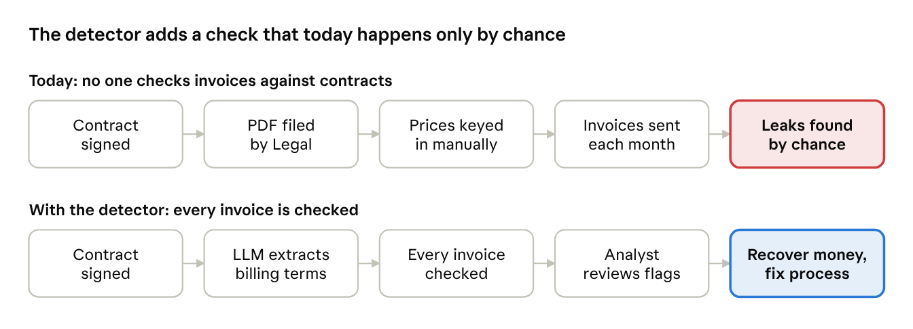
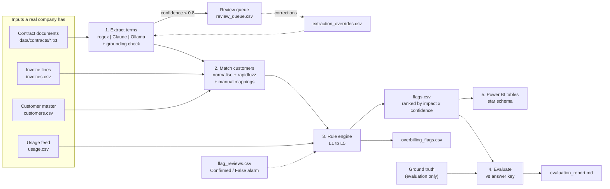

# Revenue Leakage Detector

**Finding money companies have earned but never billed by checking every invoice against the contract it should follow.**

Revenue leakage is revenue a company is owed under its contracts but never invoices or collects. Industry estimates commonly put it at 1–5% of revenue. It goes unnoticed because contract terms sit in PDFs owned by Sales and Legal, while invoices sit in the billing system owned by Finance, and nobody systematically checks one against the other.

This project is an end-to-end business analysis case study: requirements, process redesign, a synthetic dataset, a detection engine and a Finance dashboard.



---

## Results

On a synthetic dataset of 500 contracts and 25,199 invoice lines (USD 99.2M billed):

| Metric | Target (BRD) | Result |
| --- | --- | --- |
| Leakage found | | **USD 2.02M across 4,722 flags (2.0% of revenue)** |
| Leak recall | ≥ 90% | **100.0%** (4,828 of 4,828 planted leaks) |
| Flag precision | ≥ 90% | **99.98%** (1 false alarm) |
| Leakage value found | ≥ 90% of planted USD | **100.0%** |
| Extraction accuracy (regex) | ≥ 95% of fields | **100.0%** of 8,958 fields |
| Invoice match rate | ≥ 97% | **98.0%** (every unmatched line is a genuine no-contract line) |
| Full run time | < 30 min | **about 2 minutes**, including evaluation (regex extractor) |

**Where the money goes:**

| Leak type | Flags | USD | Share |
| --- | ---: | ---: | ---: |
| L2 Expired discount still applied | 1,672 | 1,115,285 | 55% |
| L5 Wrong tax rate (under-charged) | 970 | 363,602 | 18% |
| L3 Unbilled overage | 985 | 227,437 | 11% |
| L1 Missed price escalation | 967 | 213,944 | 11% |
| L4 Wrong unit price | 128 | 95,071 | 5% |
| **Total** | **4,722** | **2,015,339** | |

Separately, **USD 112,788 of over-billing** (218 flags) was found. All of it is UAE customers charged a higher tax rate than the 5% VAT, which is a customer-relations risk rather than leakage.

**Regex vs LLM extraction:** see [the evaluation report](output/evaluation_report.md). The free regex baseline is perfect on these templated contracts. The local 3B LLM (Ollama, free) got 90.4% (50-contract sample) of fields right. Because every extracted value is checked against the contract text, **every wrong value was sent to the review queue instead of creating a false flag**.

The full write-up is in the [case study](docs/case_study.md).

## Business problem

| Leak type | Example | Rule |
| --- | --- | --- |
| **L1** Missed price escalation | Contract says +4% each year, invoices stay at the old price | Billed price < contract price × (1 + escalation %) after the anniversary |
| **L2** Expired discount still applied | 15% intro discount ended in March, still on invoices in August | Discount on an invoice dated after the discount end date |
| **L3** Unbilled overage | Customer used 320K API calls on a 250K plan, no overage charged | Usage > tier limit and no overage line |
| **L4** Wrong unit price | Price keyed as 40.50 instead of 45.00 | Billed price differs from contract by > 0.5% with no explanation |
| **L5** Wrong tax rate | UAE customer billed 10% instead of 5% VAT | Tax rate ≠ rate for the customer's billing country |

Tax checks cover **UAE VAT (5%)**, **Australia GST (10%)**, **New Zealand GST (15%)** and EU VAT for Germany, the Netherlands and Ireland.

## Architecture



The detector reads **only** the four inputs on the left. The ground-truth files (`contracts.csv`, `contract_lines.csv`, `planted_leaks.csv`) are read only by `src/evaluate.py`.

## How to run

Windows PowerShell, Python 3.10+:

```powershell
# one-time setup
python -m venv .venv
.\.venv\Scripts\python.exe -m pip install -r requirements.txt

# (optional) regenerate the synthetic data
.\.venv\Scripts\python.exe generate_data.py --seed 42 --out data

# run the whole pipeline: extract -> match -> detect -> evaluate -> Power BI export
.\.venv\Scripts\python.exe -m src.run_pipeline

# run the tests
.\.venv\Scripts\python.exe -m pytest -q

# (re)build the Power BI dashboard project, then open it and click Home > Refresh
.\.venv\Scripts\python.exe tools\build_powerbi_project.py
start powerbi\RevenueLeakage.pbip
```

**Power BI dashboard:** `powerbi/RevenueLeakage.pbip` is a Power BI Project. It holds the star-schema model, 8 relationships, 30 DAX measures and three pages: Executive summary, Flag review, and Root causes & tax. Open it in Power BI Desktop and click **Refresh** to load the CSVs. If you cloned the repo to another folder, first set the `DataFolder` parameter (Transform data → Edit parameters) to your `output\powerbi\` path. [docs/powerbi_dashboard_guide.md](docs/powerbi_dashboard_guide.md) explains every measure and visual.

**Using an LLM extractor instead of regex:**

```powershell
# Free and local: install Ollama from ollama.com, then
ollama pull llama3.2:3b
.\.venv\Scripts\python.exe -m src.run_pipeline --extractor ollama --limit 50

# Claude API: copy .env.example to .env and set ANTHROPIC_API_KEY (billed separately from a Claude subscription)
.\.venv\Scripts\python.exe -m src.run_pipeline --extractor anthropic
```

LLM results are cached in `output/cache/`, so a contract is never sent twice. To compare extractors without changing what detection uses, run `python -m src.extract_terms --extractor ollama --no-activate` and then `python -m src.evaluate`.

**Human-in-the-loop files** (edit, then rerun the pipeline):

| File | Who uses it | Purpose |
| --- | --- | --- |
| `output/review_queue.csv` | Contracts admin | Extracted fields with confidence < 0.8 (US-05) |
| `data/extraction_overrides.csv` | Contracts admin | Corrected values that replace extracted ones |
| `data/manual_mappings.csv` | Billing team | Invoice name → contract customer, when fuzzy matching is unsure |
| `data/flag_reviews.csv` | Billing analyst | Mark flags Confirmed / False alarm / Needs info (US-04) |
| `output/confirmed_flags_export.csv` | Billing team | Confirmed flags only, for re-billing (US-08) |

## Project structure

```
src/
  config.py            tax rates, thresholds, paths (one place to change a rate)
  extract_terms.py     FR-01..03  regex / Claude / Ollama extractors, grounding, review queue
  match_customers.py   FR-05, 12  name normalisation, fuzzy matching, contract assignment
  detect_leaks.py      FR-06..08  rules L1-L5, evidence, priority score, over-billing
  evaluate.py          NFR-01     precision / recall / USD captured, extraction accuracy
  export_powerbi.py    FR-10, 11  star-schema tables for Power BI
  run_pipeline.py      entry point: python -m src.run_pipeline
tools/
  build_powerbi_project.py   generates the Power BI Project (model, measures, report pages)
powerbi/               RevenueLeakage.pbip: open in Power BI Desktop
tests/                 pytest: every leak rule, name matching, extraction grounding
docs/                  BRD, process map, Power BI guide, case study
output/                flags, review queue, evaluation report, powerbi/ tables
```

## Key design decisions

- **Grounding check on every extracted value.** Whichever extractor produced a value, the pipeline looks for it in the contract text. A value it cannot find gets its confidence capped at 0.5, which sends it to the review queue. This guards against the main LLM risk in the BRD, an invented contract term.
- **Rules are small pure functions.** Each leak rule takes one invoice line and the contract terms and returns a flag or nothing. A Finance user can read each one against the BRD, and each has its own unit tests.
- **Flags carry their evidence.** Every flag stores the contract sentence it relied on, the expected and billed amounts, and a plain-English explanation. A reviewer can confirm it without opening the contract (US-03, NFR-05).
- **Fuzzy matches below 90 are suggestions, not matches.** Matching an invoice to the wrong customer creates false flags, so uncertain names go to a review list. The same happens when two names carry legal suffixes from different countries (`GmbH` vs `Pty Ltd`).
- **Missed escalation means the old price to the cent.** A 5% keying error after a 5% escalation lands within 0.5% of last year's price. Requiring an exact match keeps those as L4 errors, not L1, so root-cause reporting points at the right process.

## Dataset

Real contract and invoice data is confidential, so `generate_data.py` builds a realistic synthetic dataset. Leaks are planted deliberately and recorded in an answer key, so detection accuracy can be measured.

| | |
| --- | --- |
| Customers | 300 across 6 countries |
| Contracts | 500 (text documents with clause wording that varies on purpose) |
| Invoice lines | 25,199 (Jan 2024 – Oct 2026) |
| Total billed | USD 99.2M |
| Planted leakage | USD 1.96M (2.0% of revenue) across 5,048 leak records |

**Deliberately messy, like real data:**
- 18% of customers appear under a different name on invoices (`ACME LLC` vs `Acme Corp.`)
- 2% of invoice lines have no matching contract
- The same clause appears in several wordings ("increase by 4% on each anniversary" / "yearly adjustment of 4% commencing…")

| File | Contents |
| --- | --- |
| `data/contracts/*.txt` | Contract documents. **The detector reads these.** |
| `data/invoices.csv` | Invoice lines as billed. **The detector reads these.** |
| `data/usage.csv` | Monthly usage for metered products. **The detector reads these.** |
| `data/customers.csv` | Customer master. **The detector reads these.** |
| `data/contracts.csv`, `data/contract_lines.csv` | Ground-truth contract terms, used only to grade extraction |
| `data/planted_leaks.csv` | Answer key, used only to grade detection |

## Roadmap

- [x] Business Requirements Document
- [x] As-is / to-be process design
- [x] Synthetic dataset with planted leaks and answer key
- [x] LLM extraction of contract terms (structured JSON + confidence scores), with a regex baseline
- [x] Fuzzy matching of invoice customers to contracts
- [x] Rule engine for leak types L1–L5, ranked by dollar impact × confidence
- [x] Accuracy evaluation against the answer key (target: ≥ 90% recall and precision)
- [x] Power BI data model and dashboard build guide ([guide](docs/powerbi_dashboard_guide.md))
- [x] Power BI dashboard: three-page Power BI Project in [`powerbi/`](powerbi/) (screenshots to follow)
- [ ] User acceptance testing with finance professionals
- [x] Case study write-up: findings, root causes, recommendations ([case study](docs/case_study.md))

## Limitations

- The data is synthetic. The regex extractor scores 100% because it was written for these contract templates; real contracts, with scanned pages, amendments and free-form wording, are where an LLM extractor earns its cost.
- One false alarm remains: a customer holds two overlapping contracts for the same product and the invoice does not say which one it belongs to. The fix is a process change: print the contract number on every invoice.

## Skills demonstrated

Requirements elicitation · stakeholder analysis · process mapping · business rules definition · user stories & acceptance criteria · data modelling · Python · LLMs for document extraction · evaluation design · Power BI · UAT planning

## Author

**Hari** · MSc in Artificial Intelligence · aspiring Business Analyst
[LinkedIn](https://www.linkedin.com/in/your-profile) · [Email](mailto:you@example.com)
