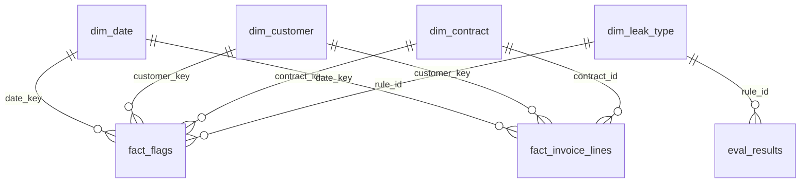

# Power BI dashboard guide

This guide builds the three-page Finance dashboard (FR-10) from the tables in `output/powerbi/`. Allow about 2–3 hours the first time. Power BI Desktop is free on Windows.

Run the pipeline first so the tables are up to date:

```powershell
.\.venv\Scripts\python.exe -m src.run_pipeline
```

## 1. The data model

The export uses a **star schema**: two fact tables (things that happened) surrounded by dimension tables (things you filter by).



| Table | Grain (one row per…) | Key columns |
| --- | --- | --- |
| `fact_flags` | flag (leakage and over-billing, including hidden flags under USD 10) | `flag_id`, `date_key`, `customer_key`, `contract_id`, `rule_id` |
| `fact_invoice_lines` | invoice line, with match status | `invoice_line_id`, `date_key`, `customer_key`, `contract_id` |
| `dim_customer` | customer (plus one `UNMATCHED` row) | `customer_key` |
| `dim_contract` | contract, with extracted terms and clause wording | `contract_id` |
| `dim_leak_type` | leak type L1–L5 | `rule_id` |
| `dim_date` | calendar day | `date_key` |
| `eval_results` | planted leak or flag, with outcome TP / FP / FN | `rule_id` |

`eval_results` exists only because this is a test dataset with an answer key. With real data you would measure precision from reviewer decisions instead (see the *Review Precision* measure).

## 2. Load the tables

1. **Home → Get data → Text/CSV**, open `output/powerbi/fact_flags.csv`, click **Transform Data** (not Load).
2. Repeat **New Source → Text/CSV** in Power Query for the other six CSV files.
3. In Power Query, set these column types (click the icon left of the column name):
   - every `date_key` column, plus `dim_date[date]`: **Date**
   - `impact_usd`, `expected_amount`, `billed_amount`, `priority_score`, `net_amount`, `planted_usd`, `flagged_usd`: **Fixed decimal number**
   - `confidence`, `tax_rate`, `standard_tax_rate`, `escalation_pct`: **Decimal number**
   - `is_visible`, `has_discount`, `has_usage_tier`: **True/False**
4. **Close & Apply**.

Tip: put the CSV folder path in a parameter (**Manage Parameters → New**, called `DataFolder`) and use it in each source step. Then the report works on another laptop after one change.

## 3. Relationships and date table

1. Open **Model view**. Power BI may auto-create some relationships; delete any that differ from this list.
2. Create these relationships, all **many-to-one, single direction**, from the fact to the dimension:

   | From (many) | To (one) |
   | --- | --- |
   | `fact_flags[date_key]` | `dim_date[date_key]` |
   | `fact_flags[customer_key]` | `dim_customer[customer_key]` |
   | `fact_flags[contract_id]` | `dim_contract[contract_id]` |
   | `fact_flags[rule_id]` | `dim_leak_type[rule_id]` |
   | `fact_invoice_lines[date_key]` | `dim_date[date_key]` |
   | `fact_invoice_lines[customer_key]` | `dim_customer[customer_key]` |
   | `fact_invoice_lines[contract_id]` | `dim_contract[contract_id]` |
   | `eval_results[rule_id]` | `dim_leak_type[rule_id]` |

3. Do **not** relate `dim_contract[customer_key]` to `dim_customer`. Customer filters already reach the facts directly, and a second path would make the model ambiguous.
4. Select `dim_date` → **Table tools → Mark as date table** → column `date`.
5. Sort `dim_date[month_name]` by `month` and `dim_leak_type[leak_type]` by `sort_order` (**Column tools → Sort by column**).
6. Hide the key columns in the fact tables (right-click → **Hide in report view**) so report builders use the dimension fields.

## 4. DAX measures

Create a table to hold the measures: **Home → Enter data**, name it `_Measures`, load it, then add each measure with **New measure**. Format currency measures as `$#,0` and percentages as `0.0%`.

```dax
// ---------- Leakage (US-01) ----------
Total Leakage =
CALCULATE (
    SUM ( fact_flags[impact_usd] ),
    fact_flags[direction] = "Under-billed",
    fact_flags[is_visible] = TRUE (),
    fact_flags[status] <> "False alarm"          // US-04: false alarms excluded
)

Confirmed Leakage =
CALCULATE ( [Total Leakage], fact_flags[status] = "Confirmed" )

Unreviewed Leakage =
CALCULATE ( [Total Leakage], fact_flags[status] = "Unreviewed" )

Needs Info Leakage =
CALCULATE ( [Total Leakage], fact_flags[status] = "Needs info" )

Total Revenue =
SUM ( fact_invoice_lines[net_amount] )

Leakage % of Revenue =
DIVIDE ( [Total Leakage], [Total Revenue] )

Leakage Flags =
CALCULATE (
    COUNTROWS ( fact_flags ),
    fact_flags[direction] = "Under-billed",
    fact_flags[is_visible] = TRUE (),
    fact_flags[status] <> "False alarm"
)

Hidden Flags (< USD 10) =
CALCULATE ( COUNTROWS ( fact_flags ), fact_flags[is_visible] = FALSE () )

// ---------- Over-billing (reported separately, BRD general rules) ----------
Over-billing =
CALCULATE (
    - SUM ( fact_flags[impact_usd] ),
    fact_flags[direction] = "Over-billed",
    fact_flags[is_visible] = TRUE ()
)

// ---------- Ranking (US-02) ----------
Priority Score =
SUM ( fact_flags[priority_score] )

Avg Confidence =
AVERAGE ( fact_flags[confidence] )

// ---------- Trend (US-06) ----------
Leakage Prev Month =
CALCULATE ( [Total Leakage], DATEADD ( dim_date[date], -1, MONTH ) )

Leakage MoM Change =
[Total Leakage] - [Leakage Prev Month]

Leakage MoM % =
DIVIDE ( [Leakage MoM Change], [Leakage Prev Month] )

// ---------- Tax (US-07) ----------
Tax Under-charged =
CALCULATE ( SUM ( fact_flags[impact_usd] ),
    fact_flags[rule_id] = "L5", fact_flags[tax_direction] = "Under-charged",
    fact_flags[is_visible] = TRUE () )

Tax Over-charged =
CALCULATE ( - SUM ( fact_flags[impact_usd] ),
    fact_flags[rule_id] = "L5", fact_flags[tax_direction] = "Over-charged",
    fact_flags[is_visible] = TRUE () )

// ---------- Data quality (FR-12) ----------
Invoice Match Rate =
DIVIDE (
    CALCULATE ( COUNTROWS ( fact_invoice_lines ), fact_invoice_lines[match_status] = "Matched" ),
    COUNTROWS ( fact_invoice_lines )
)

Unmatched Revenue =
CALCULATE ( [Total Revenue], fact_invoice_lines[match_status] = "Unmatched" )

// ---------- Accuracy vs answer key (NFR-01, test data only) ----------
Recall =
DIVIDE (
    CALCULATE ( COUNTROWS ( eval_results ), eval_results[outcome] = "TP" ),
    CALCULATE ( COUNTROWS ( eval_results ), eval_results[outcome] IN { "TP", "FN" } )
)

Precision =
DIVIDE (
    CALCULATE ( COUNTROWS ( eval_results ), eval_results[outcome] = "TP" ),
    CALCULATE ( COUNTROWS ( eval_results ), eval_results[outcome] IN { "TP", "FP" } )
)

USD Captured % =
DIVIDE (
    CALCULATE ( SUM ( eval_results[planted_usd] ), eval_results[outcome] = "TP" ),
    CALCULATE ( SUM ( eval_results[planted_usd] ), eval_results[outcome] IN { "TP", "FN" } )
)

// ---------- Accuracy from reviewer decisions (real-world version) ----------
Review Precision =
DIVIDE (
    CALCULATE ( COUNTROWS ( fact_flags ), fact_flags[status] = "Confirmed" ),
    CALCULATE ( COUNTROWS ( fact_flags ), fact_flags[status] IN { "Confirmed", "False alarm" } )
)
```

Put the measures on `eval_results` behind a filter `eval_results[direction] = "Under-billed"` on the visual (or the page) when you show leakage accuracy only.

## 5. Page 1 — Executive summary (US-01)

**Question it answers:** "How much revenue are we losing, and is it getting better?"

| Visual | Fields |
| --- | --- |
| 5 cards (top row) | Total Leakage · Confirmed Leakage · Unreviewed Leakage · Leakage % of Revenue · Over-billing |
| Line chart | X: `dim_date[year_month]` · Y: Total Leakage · secondary Y: Leakage % of Revenue |
| Clustered bar | Y: `dim_leak_type[leak_type]` · X: Total Leakage · data labels on |
| Bar | Y: `dim_customer[customer_name]` · X: Total Leakage · **Top N = 10** filter |
| Donut | Legend: `fact_flags[status]` · Values: Total Leakage |
| Slicers | `dim_date[year_quarter]`, `dim_customer[country_name]`, `dim_leak_type[leak_type]` |

Acceptance check for US-01: with no filters, *Total Leakage* must equal the sum of `impact_usd` in `output/flags.csv` (the pipeline prints this total). Write the number on a sticky note and compare.

## 6. Page 2 — Flag review (US-02, US-03)

**Question it answers:** "Which flags should I fix first, and is each one real?"

1. **Table visual** with: `flag_id`, `invoice_id`, `dim_customer[customer_name]`, `dim_leak_type[leak_type]`, `impact_usd`, `confidence`, `priority_score`, `status`.
   - Sort by `priority_score` descending (US-02).
   - Visual-level filters: `direction = Under-billed`, `is_visible = True`.
   - Conditional formatting on `impact_usd`: data bars.
2. Slicers: `status`, `leak_type`, `country_name`, plus a numeric range slicer on `confidence`.
3. **Drill-through page "Flag detail"** (US-03):
   - Create a new page, add `fact_flags[flag_id]` to **Drill through** in the Visualizations pane.
   - Add multi-row cards: `invoice_id`, `invoice_line_id`, `invoice_customer_name`, `contract_id`, `rule_id`, `leak_type`.
   - Add cards for `expected_amount`, `billed_amount` and `impact_usd`, so expected and billed sit side by side.
   - Add two **text-box style tables** (single column, word wrap on) for `evidence_clause` and `rule_detail`. This is the contract clause next to the invoice line, so the analyst never has to open the contract.
   - Right-click any row on the Flag review page → **Drill through → Flag detail**.
4. A small **Top 20 flags** table (FR-10): same columns, **Top N = 20 by Priority Score**.

**Marking a flag (US-04).** Power BI reports are read-only, so reviewer decisions are stored in `data/flag_reviews.csv` (`flag_id, status, reviewed_by, reviewed_on, note`, with status `Confirmed`, `False alarm` or `Needs info`). Edit the file, rerun the pipeline and refresh Power BI. The new status shows on the dashboard, and false alarms drop out of *Total Leakage*. `output/confirmed_flags_export.csv` then holds only Confirmed flags for the Billing team (US-08). In a production rollout this file would become a SharePoint list or a Power Apps form embedded in the report.

## 7. Page 3 — Root causes & tax (US-06, US-07)

**Question it answers:** "Which process is leaking, and which tax filings need correcting?"

| Visual | Fields |
| --- | --- |
| Matrix | Rows: `dim_leak_type[leak_type]` · Columns: `dim_date[year_month]` · Values: Total Leakage, Leakage MoM % (US-06 month-on-month change) |
| Bar | Y: `dim_leak_type[process_owner]` · X: Total Leakage (the team that can fix the cause) |
| Clustered bar | Y: `dim_contract[escalation_wording]` · X: Total Leakage · filter `rule_id = L1` (does one clause wording leak more?) |
| Clustered bar | Y: `dim_contract[discount_wording]` · X: Total Leakage · filter `rule_id = L2` |
| Matrix (tax, US-07) | Rows: `dim_customer[country_name]` · Values: Tax Under-charged, Tax Over-charged, count of L5 flags |
| Map or filled map (optional) | Location: `dim_customer[country_name]` · Size: Tax Under-charged |
| Cards (data quality) | Invoice Match Rate · Unmatched Revenue · Recall · Precision |

Add a page-level filter `rule_id = L5` to a copy of the tax matrix if the Tax team wants a page of their own.

## 8. Finishing touches

- **Theme:** View → Themes → pick a calm one, or import a JSON theme with your brand colours. Use red only for leakage and grey for everything else.
- **Titles that state the answer:** "L2 expired discounts are 55% of leakage", not "Leakage by type".
- **Tooltips:** add `rule_detail` to the table tooltip on page 2.
- **Bookmarks:** create a "Reset filters" bookmark and a button for it.
- **Publish:** File → Save as `RevenueLeakage.pbix`. Add a screenshot of each page to `docs/` and the README. The `.pbix` can go in the repo; it is small because the data is CSV.

## 9. UAT checklist (BRD UAT plan)

| Test | Story | Pass when |
| --- | --- | --- |
| UAT-01 | US-01 | Total Leakage equals the pipeline total; quarter, country and leak-type slicers all filter it |
| UAT-02 | US-02 | Flag table is sorted by priority score, highest first, with customer, type, USD and invoice number |
| UAT-03 | US-03 | Drill-through shows clause, invoice line, rule, expected and billed amounts |
| UAT-04 | US-04 | A status set in `flag_reviews.csv` appears after refresh; a False alarm leaves Total Leakage |
| UAT-05 | US-05 | Every field below 0.8 appears in `output/review_queue.csv`; a value in `data/extraction_overrides.csv` replaces it on the next run |
| UAT-06 | US-06 | Leakage by type and by clause wording is shown, with month-on-month change |
| UAT-07 | US-07 | L5 can be filtered by country, with under- and over-charged tax shown separately |
| UAT-08 | US-08 | `confirmed_flags_export.csv` contains only Confirmed flags, with invoice, customer, expected, billed and difference |
